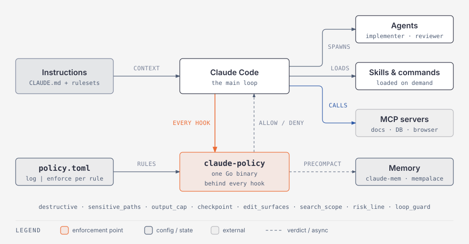

# polo's incredible harness

A Claude Code setup that got out of hand. Global instructions, rulesets, agents, skills, hooks, MCP servers, and one Go binary that reads every hook event and says no when it has to.

Built around Magento 2 / PHP work, but most of it is stack-agnostic.



## The idea

Prose rules get ignored under pressure. So the setup splits in two:

- **Instructions say what to do.** `CLAUDE.md` stays short and points at rulesets that are read on demand (`routing.md` decides how much process a task deserves, `ponytail.md` keeps the code small).
- **`claude-policy` enforces what must not happen.** One static binary sits behind every hook. It blocks destructive commands, keeps secrets unread, caps oversized tool output, and checks that a turn that edited code ends with a risk line.

## What is in the box

| Path | What it is |
|---|---|
| `claude/CLAUDE.md` | Global instructions: role, code-generation discipline, token discipline, pointers to rulesets |
| `claude/rulesets/` | `core/` (routing, review, security, planning, architecture, ponytail) and `frameworks/` (Magento 2, Laravel) |
| `claude/agents/` | `implementer`, `implementer-deep`, `reviewer`, `ui-verifier`, the `judgment-*` judges and fixer |
| `claude/skills/` | Debugging, TDD, verification, commits, planning, Jira context, Magento upgrade estimation and cloud audit, OpenSpec helpers |
| `claude/commands/` | `m2-init`, `m2-review`, `m2-fix-objectmanager`, `ponytail-review`, `ponytail-audit` |
| `claude/hooks/` | `secret-guard.sh` and the status line scripts |
| `claude/settings.json` | Permissions, hook wiring, per-model effort, enabled plugins |
| `claude/policy.toml` | Which `claude-policy` rules run in `log` or `enforce` mode |
| `mcp.json` | MCP servers in `.mcp.json` shape, secrets as `${NAME}` references |
| `plugins.json` | Marketplaces and installed plugin versions |
| `links.txt` | Skills that are symlinks into public repositories: listed, not copied |

## claude-policy

**Repository: [iampolo87/claude-policy](https://github.com/iampolo87/claude-policy)**

Every hook in `claude/settings.json` (`SessionStart`, `UserPromptSubmit`, `PreToolUse`, `PostToolUse`, `PostToolUseFailure`, `PreCompact`, `PostCompact`, `Stop`) and the status line call the same binary:

```
~/.local/bin/claude-policy hook
```

It reads the hook JSON on stdin, loads `~/.claude/policy.toml`, runs the rules that match the event, and prints one decision. It always exits 0 and fails open, so a bug in it cannot brick a session. Each rule is `off`, `log` or `enforce`; a fresh install starts everything in `log`, where a rule records what it would have done and changes nothing.

| Rule | What it does |
|---|---|
| `destructive` | Parses shell commands (wrappers, `$(…)`, heredocs, `bash -c`) and stops irreversible `git`, filesystem, SQL and `bin/magento` operations |
| `sensitive_paths` | Subagents may not touch the configured paths (`.env`, …) |
| `edit_surfaces` | A subagent whose brief lists `## Allowed edit surfaces` may edit only those paths |
| `pii_egress` | Asks before a call carries your account email, or a configured string, to the outside |
| `commit_message` | Denies a commit whose message is too long, carries AI attribution, or skips the pre-commit hooks |
| `loop_guard` | Stops the same failing command from being retried unchanged |
| `ponytail` | Denies new code that hand-rolls something the platform already provides |
| `output_cap` | Replaces an oversized Bash or MCP result with head, pointer and tail, and writes the full text to the session scratchpad |
| `search_scope`, `search_batch` | Says when a recursive search skipped a gitignored directory; nudges one-per-message lookups into a batch |
| `lint` | `php -l` / `node --check` on the edited file |
| `risk_line` | Reminds the main agent to end a code-editing turn with a `Risk:` line |
| `checkpoint` | Writes edited files, last prompts and `git status` before a compaction and injects them after it |
| `explore_model`, `time_budget`, `session_notice` | Default model for `Explore` subagents, an advisory clock, session-start notices |

The full list, the configuration reference and the hook block are in the [claude-policy README](https://github.com/iampolo87/claude-policy#readme).

### Install it for this setup

`claude/settings.json` expects the binary at `~/.local/bin/claude-policy`:

```bash
GOBIN="$HOME/.local/bin" go install github.com/iampolo87/claude-policy/cmd/claude-policy@latest   # needs Go 1.26+
claude-policy config check
```

`claude/policy.toml` is the rule configuration this setup runs: the listed rules are in `enforce`, `destructive` is still in `log`.

Two entries in `claude/settings.json` use optional integrations that are off by default in `claude-policy`. Enable them in `policy.toml`, or remove the entries:

| Entry | Needs |
|---|---|
| `PreCompact` → `claude-policy mine` | `[integrations.mempalace]` (transcript mining into mempalace) |
| `statusLine` → `claude-policy statusline <renderer>` | Works as is; `[integrations.herdr]` adds reporting to the herdr pane |

## Use it

```bash
rsync -a claude/ ~/.claude/          # or copy only the parts you want
cp mcp.json <project>/.mcp.json      # export the ${NAME} variables it references first
# plugins.json: /plugin marketplace add <repo>, then /plugin install <name>@<marketplace>
```

Paths use `${HOME}`. External pieces: `claude-policy` (above), the MCP server binaries named in `mcp.json`, and `hc` (herdr) for `skills/herd-fleet`.

## Export your own

`sync.sh` is how this repository is produced, and it works on any `~/.claude`.

```bash
cp sync.local.example.sh sync.local.sh   # gitignored: what to exclude, rename and reject
./sync.sh
```

In order, it:

1. Copies an allowlist from `~/.claude`. Credentials, history, sessions, projects, caches, hidden files, logs and archives are never copied.
2. Lists symlinked skills in `links.txt` when the target has a git remote, and copies them otherwise.
3. Writes MCP servers from `~/.claude.json` with every `env` and header value replaced by a `${NAME}` reference.
4. Rewrites the home directory to `${HOME}`, then applies your `REPLACE` expressions.
5. Refuses binary files, then runs a secret scan and a `PRIVATE_TERMS` scan. Any failure exits 1 and prints `file:line` only.

It refuses to run without `sync.local.sh`. The scans are pattern based, so read the diff before every push.

## What was changed for publication

- Client names, internal hostnames and ticket keys were replaced with neutral ones (`client-a`, `Vendor`, `PROJ-123`).
- Left out: skills and playbooks that carried real project data, the employer-specific estimation skill and coding standard, and `rulesets/core/orchestration.md` (a machine-specific inventory). `CLAUDE.md` and `routing.md` still point at some of these files.
- Third-party packs that can be installed from upstream were left out too.

## Credits

Several skills and rulesets are adapted from other people's work. Sources and licences are in [THIRD_PARTY.md](THIRD_PARTY.md).
